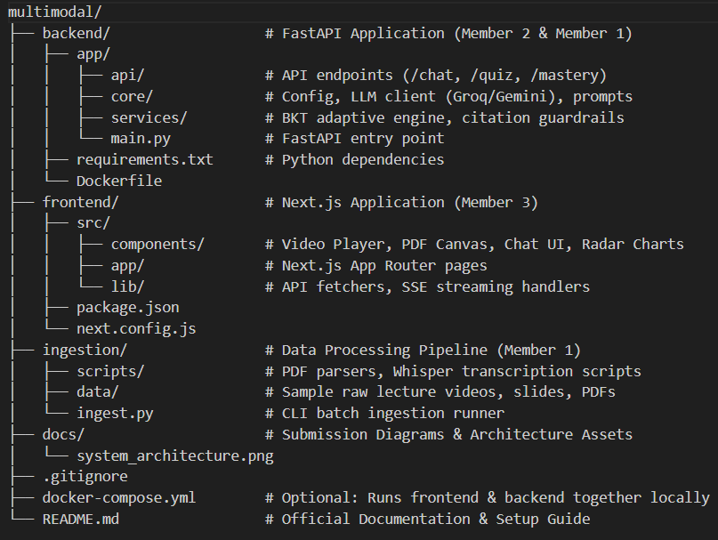

# Multimodal AI Study Companion (Track D) 🎓

An interactive AI-powered study companion that ingests lecture videos, textbooks, and slides into a source-cited knowledge base to run adaptive assessments and personalized tutoring.

## 🚀 Key Features
- **Source-Cited Grounding:** Every AI answer includes exact timestamp and slide citations.
- **Deep-Linked Video Player:** Click any citation to jump directly to the exact video frame or slide page.
- **Adaptive Knowledge Tracing:** Bayesian Knowledge Tracing (BKT) dynamically adjusts quiz difficulty based on student mastery.

## 🛠️ Tech Stack
- **Frontend:** Next.js, Tailwind CSS, Video.js, react-pdf, Recharts
- **Backend:** FastAPI, Python, Pydantic
- **AI/ML:** Groq API (Llama 3), ChromaDB/Qdrant, `faster-whisper`, `sentence-transformers`



## 🏁 Quick Start

### Backend
```bash
cd backend
python -m venv venv
source venv/bin/activate  # Or `venv\Scripts\activate` on Windows
pip install -r requirements.txt
uvicorn app.main:app --reload
http://127.0.0.1:8000/docs